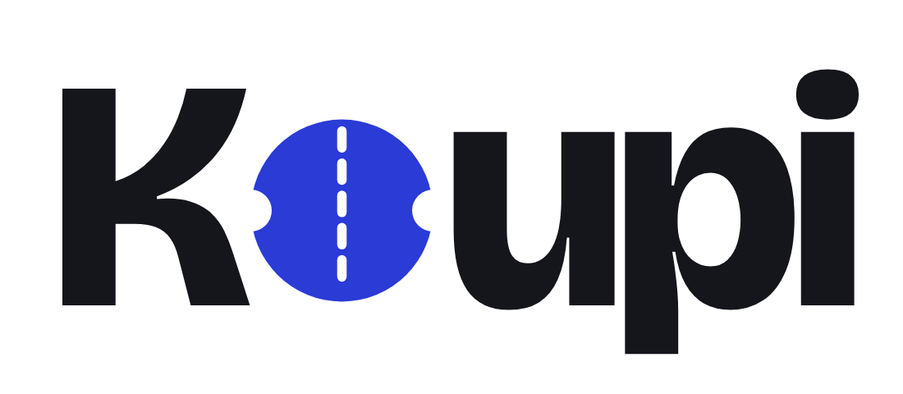

<div align="center">

<picture>
  <source media="(prefers-color-scheme: dark)" srcset="public/koupi-logo-dark.png">
  
</picture>

### Le code du créateur, vérifié.

Les codes promo que les créateurs donnent en vidéo, réunis au même endroit,<br>
reliés à leur source, crédités à leur créateur et testés par la communauté.

[](CHANGELOG.md)
[](https://github.com/CodeShadowing95/koupi/actions/workflows/ci.yml)
[](https://nextjs.org)
[](https://www.typescriptlang.org)
[](https://www.conventionalcommits.org/fr/v1.0.0/)

[Fonctionnalités](#fonctionnalités) · [Démarrage rapide](#démarrage-rapide) · [Architecture](#architecture) · [Contribuer](#contribuer) · [Changelog](CHANGELOG.md)

</div>

<br>

<p align="center">
  
</p>

## À propos

Avant de payer un abonnement à un outil en ligne (hébergement, VPN, IA, logiciels pour freelances, outils de création), beaucoup de gens cherchent le code promo qu'un créateur a donné dans une vidéo. Ces codes sont éparpillés, souvent expirés, et les sites de coupons classiques ne disent ni d'où ils viennent ni s'ils marchent.

Koupi part de la source : chaque code est rattaché à la vidéo ou au post qui l'a donné, crédite le créateur qui l'a négocié, et affiche son taux de réussite selon les votes des visiteurs. Pas de compte, pas de publicité.

**Version actuelle : <!-- koupi:version -->0.1.0<!-- /koupi:version -->** · voir le [changelog](CHANGELOG.md) · statut : V0 en préparation, pas encore ouverte au public.

## Fonctionnalités

**Site public**

- **Recherche** d'un outil depuis l'accueil, avec suggestions, et pages par **catégorie**.
- **Fiche outil** : tous les codes de créateurs, la source, la date du dernier test, copie du code en un clic.
- **Page créateur** avec ses codes et sa photo de profil.
- **Votes** « ça marche / ça ne marche plus » et mesure d'audience anonyme, stockée dans notre propre base.
- **Proposer un code**, protégé par Cloudflare Turnstile et une limite de débit.
- **Trousseau** des créateurs suivis, gardé dans le navigateur, sans compte.
- Page **Transparence** sur la façon dont les codes sont trouvés et vérifiés.

**Back-office** (`/admin`)

- Modération des propositions, gestion des codes, outils, créateurs et catégories.
- Tableau de bord avec statistiques (Chart.js), recherche globale et export CSV.
- Rappel de retester les codes vérifiés depuis plus de 30 jours.

## Stack

| Domaine | Technologie |
| --- | --- |
| Application | [Next.js 15.5](https://nextjs.org) (App Router), [React 19](https://react.dev), TypeScript strict |
| Interface | CSS sur mesure, animations [GSAP](https://gsap.com), son synthétisé (Web Audio) |
| Données | [Neon](https://neon.tech) (Postgres serverless), [Drizzle ORM](https://orm.drizzle.team) |
| Tests | [Vitest](https://vitest.dev), [PGlite](https://pglite.dev) (Postgres en mémoire, vraies migrations) |
| Sécurité | Cloudflare Turnstile, limite de débit, en-têtes de sécurité, session admin signée |
| Hébergement | [Vercel](https://vercel.com) : `develop` en pré-production, `main` en production |
| CI/CD | GitHub Actions : typecheck, tests, build, audit des dépendances, releases automatisées |

## Démarrage rapide

**Prérequis** : Node.js 22 et npm, une base Postgres [Neon](https://neon.tech) (l'offre gratuite suffit).

```bash
git clone https://github.com/CodeShadowing95/koupi.git
cd koupi
npm ci
cp .env.example .env.local   # puis remplir les valeurs
npm run db:migrate           # crée les tables
npm run db:import            # importe le catalogue d'outils et de codes
npm run dev                  # http://localhost:3000
```

### Variables d'environnement

Toutes les variables sont listées, sans valeur, dans [`.env.example`](.env.example). Elles vont dans `.env.local` en local et dans les réglages Vercel en ligne. Aucun secret n'est jamais commité.

| Variable | Rôle |
| --- | --- |
| `DATABASE_URL` | Connexion à la base Neon |
| `ADMIN_PASSWORD`, `SESSION_SECRET` | Accès au back-office et signature de sa session |
| `HASH_SALT` | Anonymisation des votes et de l'audience |
| `NEXT_PUBLIC_TURNSTILE_SITE_KEY`, `TURNSTILE_SECRET_KEY` | Protection du formulaire de proposition |
| `NEXT_PUBLIC_APP_URL` | Adresse publique du site |
| `YOUTUBE_API_KEY`, `LOGO_DEV_TOKEN` | Scripts locaux uniquement (avatars des créateurs, logos des outils) |

### Scripts

| Commande | Description |
| --- | --- |
| `npm run dev` | Serveur de développement |
| `npm run build` / `npm start` | Build de production et démarrage |
| `npm run typecheck` | Vérification des types |
| `npm test` | Tests unitaires et de base de données |
| `npm run db:generate` | Génère une migration après un changement de `db/schema.ts` |
| `npm run db:migrate` | Applique les migrations (automatique sur Vercel) |
| `npm run db:import` | Importe les outils et codes de `data/` absents de la base |
| `npm run logos` / `npm run avatars` | Télécharge les logos des outils et les photos des créateurs |
| `npm run release` | Prépare une nouvelle version (voir [Versions et releases](#versions-et-releases)) |

## Architecture

```text
app/
  (site)/        Site public : accueil, /tools, /creators, /search, /submit…
  admin/         Back-office, protégé par middleware.ts
  api/           Routes API (recherche, votes, audience, propositions, administration)
components/      Composants partagés (components/site pour le site public)
lib/             Logique métier, chaque module testé à côté (x.ts → x.test.ts)
db/              Schéma Drizzle, connexion et migrations
data/            Catalogue source des outils et des codes
scripts/         Migrations, import, logos, avatars, release
docs/            Décisions d'architecture (ADR) et guides
```

Les choix structurants sont documentés dans les [décisions d'architecture](docs/decisions/README.md) : passage à Neon et Drizzle, migrations au déploiement, Turnstile, refonte du site public, catalogue en base, audience anonyme, processus de release.

## Environnements

| Branche | Environnement | Déploiement |
| --- | --- | --- |
| `main` | Production | Automatique sur Vercel à chaque release |
| `develop` | Pré-production (recette) | Automatique sur Vercel à chaque merge |
| `dev-*` | Développement | Jamais déployées, vérifiées par la CI |

Les migrations de base de données sont appliquées avant chaque build Vercel.

## Versions et releases

Koupi suit le [versionnage sémantique](https://semver.org/lang/fr/). Le numéro de version est calculé à partir des messages de commit ([Conventional Commits](https://www.conventionalcommits.org/fr/v1.0.0/)) :

```bash
npm run release -- --dry-run   # aperçu de la version et du changelog
npm run release                # prépare la version et ouvre la PR
```

La commande met à jour `package.json`, ce README et le [changelog](CHANGELOG.md), puis ouvre une PR vers `develop`. Une fois la version validée en recette, la PR de release `develop` → `main` met en production, et GitHub crée le tag et la [release](https://github.com/CodeShadowing95/koupi/releases). Le processus complet, hotfix compris, est décrit dans [`docs/release.md`](docs/release.md).

## Contribuer

1. Partir de `develop` sur une branche `dev-<sujet>`.
2. Commits et titre de PR au format `<type>(<scope>): <description>`, en anglais (ex. `feat(search): add category filter`).
3. Vérifier en local : `npm run typecheck && npm test && npm run build`.
4. Ouvrir une PR vers `develop` en suivant le [modèle](.github/pull_request_template.md). La CI doit être verte avant le merge.

Les règles complètes (types de commit, conventions, limites) sont dans [`CLAUDE.md`](CLAUDE.md).

## Sécurité

Pour signaler une faille, merci de ne pas ouvrir d'issue publique. Utilise le [signalement privé de GitHub](https://github.com/CodeShadowing95/koupi/security/advisories/new).

## Licence

Aucune licence open source n'est publiée pour l'instant : le code est visible, mais tous droits sont réservés.
